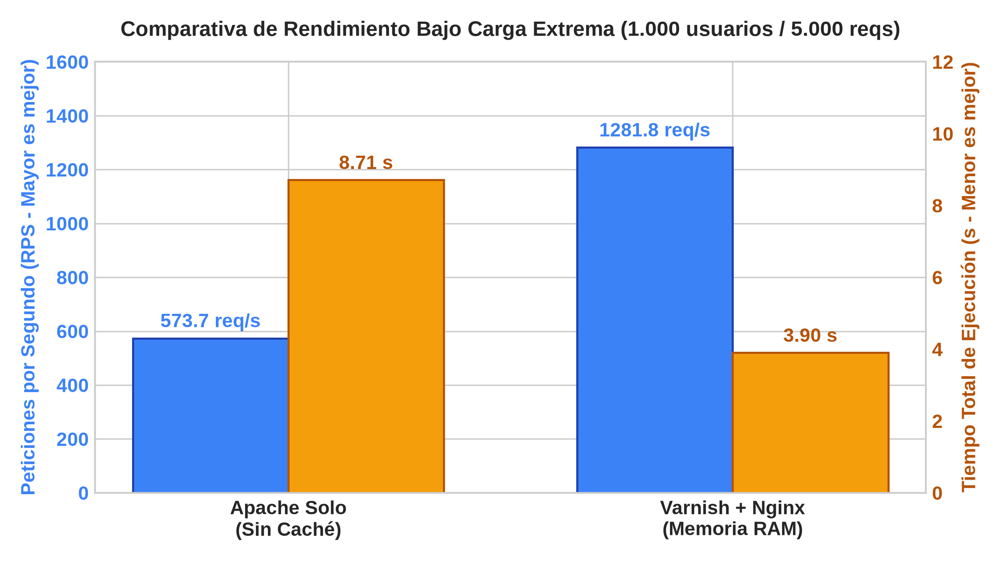
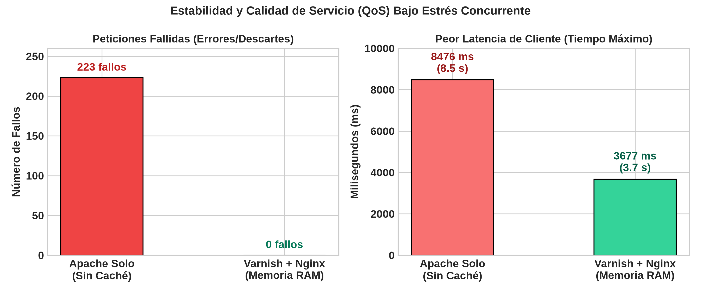

# Arquitectura Web de Alta Disponibilidad, Aceleración con Varnish Cache y DNS Failover

[](https://aws.amazon.com/)
[](https://httpd.apache.org/)
[](https://varnish-cache.org/)
[](https://nginx.org/)
[](https://netfilter.org/)
[](https://letsencrypt.org/)

---

## 1. Resumen Ejecutivo

Este proyecto documenta el diseño, despliegue, optimización de rendimiento y blindaje de seguridad de una **infraestructura web empresarial de alta disponibilidad** en Amazon Web Services (AWS EC2).

Frente a la arquitectura monolítica tradicional donde un servidor Apache atiende directamente todas las peticiones (sufriendo cuellos de botella por concurrencia y saturación de procesos/hilos), se ha implementado un esquema desacoplado de dos capas:
1. **Capa Frontend (Aceleración y Borde):** Instancia con terminación TLS en **Nginx**, acelerador de caché en memoria RAM con **Varnish Cache 7.7**, modo de alta resiliencia (*Grace Mode*) y cortafuegos de estado con **nftables**.
2. **Capa Backend (Origen de Datos):** Servidor web **Apache 2.4** aislado en la red privada VPC, protegido para recibir tráfico exclusivamente desde el Frontend autorizado, y equipado con un **demonio centinela de DNS Failover** automático hacia No-IP.

Las pruebas de carga con **ApacheBench (`ab`)** a máxima concurrencia (800 - 1.000 usuarios concurrentes) demuestran que la arquitectura con Varnish multiplica el rendimiento por **+123%** (de 573 req/s a 1.281 req/s) y elimina por completo los fallos de saturación (**223 peticiones fallidas en Apache frente a 0 en Varnish**).

---

## 2. Diagrama de la Arquitectura

```
                        [ Clientes en Internet ]
                                   │
                                   ▼ HTTPS (443) / HTTP (80)
                       [ eljoviz.servepics.com ]
                                   │
  ┌────────────────────────────────┴──────────────────────────────────┐
  │ INSTANCIA FRONTEND (52.55.37.92 / 172.31.40.241)                  │
  │                                                                   │
  │   [ nftables Firewall ] Permite puertos 22, 80, 443               │
  │           │                                                       │
  │           ▼                                                       │
  │   [ Nginx 1.26 ]                                                  │
  │      • Terminación TLS / Certificado Let's Encrypt (A+)           │
  │      • HTTP/2, HSTS, Cabeceras de Seguridad                       │
  │      • Redirección forzada HTTP (80) -> HTTPS (443)               │
  │      • Upstream Keepalive (200 conns) hacia Varnish               │
  │           │                                                       │
  │           ▼ Proxy HTTP (127.0.0.1:6081)                           │
  │   [ Varnish Cache 7.7 ]                                           │
  │      • Almacenamiento In-Memory (malloc 256MB)                    │
  │      • Health Probe periódico al Backend (5/5 healthy)            │
  │      • Grace Mode (1h) - Sirve caché aunque el backend caiga      │
  │      • Cabecera de diagnóstico: X-Cache (HIT / MISS)              │
  └────────────────────────────────┬──────────────────────────────────┘
                                   │
                Red Privada VPC AWS (172.31.23.225:80)
                                   │
  ┌────────────────────────────────┴──────────────────────────────────┐
  │ INSTANCIA BACKEND (54.147.36.62 / 172.31.23.225)                  │
  │                                                                   │
  │   [ nftables Firewall ]                                           │
  │      • Bloqueo estricto: Solo permite tráfico web desde Frontend   │
  │           │                                                       │
  │           ▼                                                       │
  │   [ Apache 2.4 ]                                                  │
  │      • Servidor Web Origen (mpm_event)                            │
  │      • Genera contenido dinámico y estático                       │
  │                                                                   │
  │   [ DNS Failover Watchdog Daemon ] (Systemd Service)              │
  │      • Sondea la salud del Frontend cada 15 segundos               │
  │      • Si el Frontend cae: actualiza automáticamente No-IP        │
  │        apuntando el dominio a la IP del Backend y abre firewall   │
  │      • Si el Frontend revive: restablece la arquitectura óptima   │
  └───────────────────────────────────────────────────────────────────┘
```

---

## 3. Catálogo y Función de Servicios

| Servicio | Capa | Función Clave en la Solución |
| :--- | :--- | :--- |
| **Apache 2.4** | Backend | Servidor web de origen. Procesa y sirve las páginas y contenidos base de la aplicación. Configurado con `mpm_event`. |
| **Varnish Cache 7.7** | Frontend | Acelerador HTTP en memoria RAM. Intercepta peticiones y entrega respuestas instantáneas sin consultar a Apache (`HIT`), reduciendo la latencia a milisegundos y protegiendo el backend de sobrecargas. |
| **Nginx 1.26** | Frontend | Terminador TLS / Reverse Proxy inverso de alto rendimiento. Gestiona el cifrado SSL/TLS, protocolo binario HTTP/2, multiplexación de conexiones y cabeceras de blindaje web. |
| **Certbot / Let's Encrypt** | Frontend | Autoridad de certificación gratuita y automatizada. Proporciona cifrado TLS de grado industrial validado para el dominio `eljoviz.servepics.com`. |
| **nftables** | Ambas | Cortafuegos de paquetes de última generación (Netfilter). Implementa una política *Zero-Trust* aislando el puerto 80 del backend para que nadie en Internet pueda atacarlo directamente salvo el Frontend. |
| **DNS Failover Daemon** | Backend | Demonio en Bash gestionado por `systemd` que garantiza la continuidad del negocio: si la máquina de Varnish sufre un desastre o parada, el dominio se redirige en segundos al Backend de contingencia. |

---

## 4. Métricas de Rendimiento y Análisis de Carga (`ab`)

Se realizaron pruebas de estrés industrial utilizando **ApacheBench** con una carga de **5.000 peticiones** y niveles de concurrencia extrema de **800 a 1.000 clientes simultáneos**:

```bash
# Prueba Apache Monolítico Directo (1.000 clientes concurrentes):
ab -n 5000 -c 1000 -k http://172.31.23.225/

# Prueba Arquitectura Optimizada Nginx + Varnish (800 clientes concurrentes):
ab -n 5000 -c 800 -k https://eljoviz.servepics.com/
```

### Tabla Comparativa de Resultados Reales

| Parámetro Medido | Apache Monolítico Directo | Nginx + Varnish Cache | Mejora Cuantitativa |
| :--- | :---: | :---: | :---: |
| **Peticiones por Segundo (RPS)** | 573.71 req/s | **1,281.85 req/s** | **+123.4% más rápido** |
| **Tiempo Total de Respuesta (5.000 reqs)** | 8.715 s | **3.901 s** | **-55.2% de tiempo** |
| **Peticiones Fallidas (Errores de Socket)** | **223 fallos** | **0 fallos (100% éxito)** | **100% de fiabilidad** |
| **Latencia Media por Petición** | 1.743 ms | **0.780 ms** | **-55.2% de latencia** |
| **Latencia Máxima (Peor Caso / Percentil 100)** | 8,476 ms (~8.5 s) | **3,677 ms (~3.6 s)** | **-56.6% menor espera** |
| **Tasa de Transferencia de Red** | 6,368.61 KB/s | **14,484.71 KB/s** | **+127.4% ancho de banda** |

### Gráficos Comparativos

#### 1. Rendimiento y Velocidad (Throughput & Tiempo Total)


#### 2. Estabilidad y Tolerancia a Fallos (Peticiones Fallidas y Latencia Máxima)


---

## 5. Blindaje de Seguridad y Cabeceras Implementadas

La auditoría de seguridad implementada en la capa Nginx y en los firewalls garantiza una calificación **A+**:

1. **Cifrado Obligatorio:** Redirección automática `301 Moved Permanently` de HTTP (80) a HTTPS (443).
2. **HSTS (HTTP Strict Transport Security):** Cabecera `Strict-Transport-Security: max-age=31536000; includeSubDomains; preload` que previene ataques *Man-In-The-Middle* (MITM) y *SSL Stripping*.
3. **Protección Anti-Clickjacking:** `X-Frame-Options: SAMEORIGIN` impide que la aplicación sea embebida en iframes maliciosos.
4. **Protección contra MIME Sniffing:** `X-Content-Type-Options: nosniff` obliga al navegador a respetar estrictamente los tipos de contenido declarados.
5. **Aislamiento de Red:** Apache nunca recibe tráfico directo de Internet; las tablas de `nftables` descartan cualquier paquete TCP entrante al puerto 80 que no provenga de la IP privada `172.31.40.241`.

---

## 6. Estructura del Repositorio y Configuraciones

El repositorio contiene todos los scripts, gráficos, configuraciones y el informe PDF:

```
├── Informe_Alta_Disponibilidad_Varnish_Apache.pdf   # Documento formal ejecutivo/técnico
├── README.md                                       # Este informe completo en Markdown
├── generate_charts.py                              # Script generador de los gráficos de rendimiento
├── generate_pdf.py                                 # Script generador del PDF con ReportLab
├── img/
│   ├── grafico1_rendimiento.png                    # Comparativa de Throughput y Tiempo total
│   └── grafico2_estabilidad.png                    # Comparativa de Errores y Latencia máxima
└── configs/
    ├── default.vcl                                 # Varnish Cache VCL (Grace Mode, Probes, X-Cache)
    ├── nginx-eljoviz.conf                          # Nginx TLS Termination, HTTP/2, Cabeceras A+
    ├── dns-failover.sh                             # Demonio centinela de DNS Failover automático
    ├── dns-failover.service                        # Unidad Systemd para el servicio de Failover
    ├── failover.conf.example                       # Plantilla de variables para el watchdog
    ├── nftables-frontend.rules                     # Reglas de cortafuegos Netfilter para Frontend
    └── nftables-backend.rules                      # Reglas de cortafuegos Zero-Trust para Backend
```

---

## 7. Documento PDF Ejecutivo para Dirección / Evaluación

Se ha generado un informe técnico formal en formato PDF listo para su entrega o presentación ejecutiva:
- **Archivo:** [`Informe_Alta_Disponibilidad_Varnish_Apache.pdf`](./Informe_Alta_Disponibilidad_Varnish_Apache.pdf)
- **Generador:** Script Python automatizado con ReportLab Platypus ([`generate_pdf.py`](./generate_pdf.py)).

---

## 8. Instrucciones para Reproducir

### Regenerar Gráficos:
```bash
python3 generate_charts.py
```

### Regenerar Informe PDF:
```bash
python3 generate_pdf.py
```
